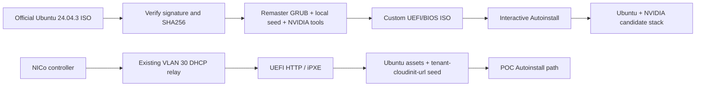

# DigiPowerX HGX B300 Custom Ubuntu Installer — Version 1 build, architecture, and test report

**Generated:** 2026-11-09 UTC
**Status:** Prepared for supervised test; physical B300/GPU validation pending.

The custom ISO path is distinct from the original NICo/iPXE POC path. The ISO does not register with NICo; BMC handling is operator-owned.

## Executive summary

V1 is a bootable Ubuntu Server 24.04.3 installer ISO for a supervised B300 test. It installs the NVIDIA R620 driver candidate, CUDA 13.5, and Fabric Manager during Autoinstall. The image is prepared and UEFI-boot-smoke-tested in QEMU; it has not been installed on the physical B300 and its GPU stack is not hardware-validated.

## Architecture

The report shows two distinct paths. The original POC path is NICo with UEFI HTTP/iPXE and a NICo-hosted NoCloud seed. The V1 custom ISO is booted using the operator's chosen media method and does not register with or call NICo. BMC handling is operator-owned and was not performed by this project.

## What was built

- Ubuntu 24.04.3 source ISO verified against Ubuntu's signed SHA256 manifest.
- Custom ISO remaster preserving BIOS and UEFI boot metadata, with local NoCloud seed and Autoinstall arguments.
- DigiPowerX login banner showing OS, kernel, uptime, CPU/RAM, root disk, address, and best-effort NVIDIA status.
- Interactive identity, disk/storage, and SSH setup; no disk serial or SSH key is baked into the image.
- Late-command installs the pinned candidate NVIDIA stack from Ubuntu/NVIDIA repositories; network access is required during installation.
- Build scripts, self-hosted GitHub Actions workflow, QEMU/OVMF smoke test, checksum/manifest, and GitHub release packaging split under the per-asset size limit.

## V1 software candidate

| Component | Pinned package(s) | Status |
| --- | --- | --- |
| NVIDIA driver | nvidia-open 620.70.06-1ubuntu1; pin package 620.70.06-1ubuntu1 | Candidate; not B300-tested |
| CUDA Toolkit | cuda-toolkit-13-5 13.5.0-1 | Candidate; repository dependencies are version-ranged |
| Fabric Manager | nvidia-fabricmanager 620-1 -> direct 2.0.0.rel106-1 | Standalone FM versioning for R620 |
| FM driver library | libnvidia-fmdrv1 620.70.06-1ubuntu1 | Pinned to matching driver package |

NVIDIA's R620 release notes mention HGX B300 and Ubuntu 24.04, and the Fabric Manager guide documents HGX B300 NVSwitch topology and independent FM versioning starting at driver release 620. These references do not constitute qualification of the exact Supermicro PIO-422GS-NB3RT. R620.70.06 was released on 2026-11-04 and is a new branch. NVIDIA's R595 branch (595.112.07, released 2026-10-22) is an older alternative, not the stack in this V1 ISO; neither branch is OEM-qualified for this exact server.

## Test evidence

- 13 local unit tests pass, including Autoinstall/GRUB behavior, DigiPowerX branding, Packer payload configuration, release split/reassembly, report generation, manifest integrity, and installer gates.
- Ubuntu source signature and ISO checksum verified; custom ISO checksum verified.
- QEMU with OVMF boots the ISO to Ubuntu 24.04.3 kernel and confirms local Autoinstall arguments. No virtual disk was attached.
- The custom ISO was built locally. The self-hosted GitHub image workflow is configured but has not yet been run.
- A separate 64-GiB Packer/QEMU qcow2 was rebuilt with the DigiPowerX MOTD and passes qemu-img integrity/checksum checks. Its NVIDIA first-boot systemd install and cloud-init user-data path remain untested; see https://github.com/likhithsatya/zel/releases/tag/b300-qemu-qcow2-firstboot-candidate-20261109.
- No complete VM installation, NVIDIA package download/install, physical B300 install, or GPU/NVSwitch validation has been performed.

## Release

ISO: digipowerx-b300-ubuntu-24.04.3-r620.iso. SHA256: 3f3ebbaaea3a4133d38f1635d13e0cb74e9c954a97ae25e0bbabec86ac3947ae. GitHub Release: https://github.com/likhithsatya/zel/releases/tag/digipowerx-b300-custom-ubuntu-24.04.3-r620-20261109. The ISO is split into two downloadable parts because GitHub limits individual release assets to under 2 GiB. Download every release asset into one directory and run bash assemble-release-iso.sh . to reconstruct and verify the ISO. The GitHub repository is public as of 2026-11-09. A separate Packer/QEMU qcow2 first-boot candidate is built; it is not a bare-metal installer and its NVIDIA first-boot service remains unvalidated.

## Before physical testing

1. Get fresh written disk-wipe approval and a dated install window; the previous POC approval does not cover this run. Likhith and Sai Rishith are the proposed test operators; schedule is pending Chakra/owner confirmation.
2. Confirm with the NICo credential custodian how the BIOS setup password is obtained and whether current lockdown/boot settings permit the selected ISO boot method. Do not bypass lockdown or change firmware settings without authorization.
3. If using BMC virtual media, verify the media session survives reboot/link interruptions. The tracker reports brief BMC network drops; that this could interrupt virtual-media boot is a risk to check, not a proven failure.
4. Agree on rollback before starting: console access, recovery media or approved NICo reprovisioning route, and how to reconcile the host back to NICo Ready. No rollback has been tested.
5. Select and verify the intended disk at the interactive installer storage screen; supervise the console.
6. Check Secure Boot/MOK requirements and confirm VLAN 30 can reach Ubuntu and NVIDIA package repositories or an approved mirror.
7. Coordinate the NICo record update because this ISO boot path bypasses NICo; no BMC/NICo action was performed by this project.
8. After installation, validate OS/SSH, then driver, all eight GPU PCI devices, nvidia-smi, CUDA, and Fabric Manager on the physical B300. Keep results separate from the QEMU smoke-test result.

## Scope boundary

This is an installer ISO, not a preinstalled raw/qcow2 image or a named Hydra-like custom image. A separate Packer qcow2 candidate exists for VM/cloud use with a first-boot NVIDIA installer service. The PXE/NICo workflow remains available separately. No BMC operation, NICo registration, disk wipe, physical installation, or GPU qualification was performed.
